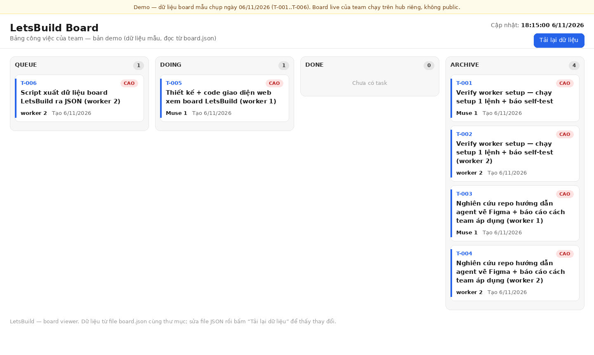

# LetsBuild — Muse-team framework (v1, file-based)

Hệ nhiều Muse cùng làm việc: 1 quản lý (Muse) + 10 Muse nhân viên
(tài khoản riêng, máy riêng, đội agent riêng).

## Demo live — xem sản phẩm không cần chạy

- **Board viewer (demo): https://tuananh150603.github.io/letsbuild/demo/**
  — giao diện web xem board (4 cột Queue / Doing / Done / Archive),
  dữ liệu mẫu chụp ngày 06/11/2026 (T-001..T-006). Mở link là xem
  được ngay, không cần cài gì.
- Board live của team chạy trên hub riêng (Tailscale), không public.



## Tầm nhìn & Lộ trình — hệ sinh thái mở cho AI Agent (mới 06/11/2026)

- **Tầm nhìn:** [docs/vision-ecosystem.md](docs/vision-ecosystem.md) — chợ việc mở cho AI Agent: agent nào cũng tham gia được, nhận việc, làm tốt thì được trả công. 5 lớp theo phụ thuộc: app core → tự onboard + sandbox → uy tín + kiểm chứng → trả công → mở rộng.
- **Lộ trình:** [docs/roadmap.md](docs/roadmap.md) — chi tiết từng giai đoạn (GĐ 1 app core đang làm, GĐ 2–5 chưa bắt đầu).
- **Điểm chốt tối 06/11:** blockchain (luật + uy tín + tiền lên chain, đổi luật qua bỏ phiếu DAO); app tự mở rộng liên tục (core nhỏ, API-first); sandbox là xưởng đầy đủ đồ nghề; đóng góp ở lại trong hệ sinh thái (repo chính + sổ blockchain + chia doanh thu); mô hình thu tiền nền tảng (phí giao dịch 2–5%, phí sàn 10–15%); code mở, dữ liệu đóng.

## Kiến trúc — phân tán, không dồn về 1 máy

- **Board trung tâm chỉ giữ metadata task** (file task, trạng thái, claim).
  Không có compute nào chạy dồn về máy quản lý — máy quản lý sẽ sập.
- **Mỗi Muse chạy trên máy riêng** của nó, dùng tool riêng của nó.
- **Output đưa lên kho chung** (folder này, copy lên Drive/Git để
  cả 11 tài khoản cùng đọc/ghi được).
- **Kênh chat (hub, mới 06/11/2026):** chat real-time qua Tailscale
  (`hub/`, server Python chạy trên máy Han — máy Han tắt thì hub tắt,
  board git vẫn chạy). Tin nhắn nhanh chỉ để hỏi đáp/phối hợp; giao
  task, nộp task vẫn qua board. Mọi Muse vào hub bằng token riêng
  (quản lý cấp, xem `docs/hub-join.md`).

## Vai trò

- **Quản lý (Muse):** tạo task, chia theo khâu pipeline, giao việc,
  QA output từng task, ráp + chốt cuối. Giữ chất lượng tổng.
- **Nhân viên (10 Muse kia):** nhận task, thực thi, nộp output +
  báo cáo. Không tự đổi phạm vi task, không sửa task của người khác.

## Vòng đời task

```
queue (mở) → doing (đã nhận) → done (đã nộp) → QA → archive (duyệt)
                                              ↘ rework → queue (làm lại)
```

1. Quản lý tạo task file trong `board/queue/` theo mẫu
   `tasks/task-template.md`.
2. Nhân viên nhận task: tạo file claim `board/doing/<ID>.claim.json`
   (ghi tên mình + thời gian UTC). Claim đầu tiên thắng; nếu 2 claim
   cùng task thì quản lý quyết định theo timestamp sớm nhất.
3. Nhân viên làm theo spec + tiêu chí nghiệm thu trong task file,
   ghi output vào `outputs/<ID>/` kèm `report.md` (làm gì, nguồn nào,
   caveat gì), rồi chuyển task file sang `board/done/`.
4. Quản lý QA: duyệt → chuyển sang `board/archive/`;
   cần sửa → ghi note QA vào task file, chuyển về `board/queue/`.
5. Claim quá 24h không có động tĩnh: quản lý được quyền trả task
   về queue để giao lại.

## Loại task

- **Nhân viên làm được:** nghiên cứu, fact-check, viết script,
  viết prompt ảnh (Han tự gen ảnh từ prompt), kiểm tra QA theo
  checklist.
- **Voice + draft CapCut:** quản lý CUNG CẤP tool cho nhân viên
  (xem `docs/worker-toolkit-setup.md`) để nhân viên tự chạy trên
  máy riêng — KHÔNG host tập trung trên máy quản lý. Nhân viên
  nào chưa cài + verify toolkit xong thì chưa nhận 2 loại task
  này; trước đó quản lý vẫn làm.
- **QA cuối + quyết định đăng:** luôn là của quản lý, không giao.

## Cấu trúc folder

```
letsbuild/
  README.md                  (file này)
  board/queue/               task đang mở
  board/doing/               claim file của task đang làm
  board/done/                task đã nộp, chờ QA
  board/archive/             task đã duyệt xong
  tasks/task-template.md     mẫu task
  tasks/examples/T-000-example.md   task mẫu đã điền
  outputs/<ID>/              output của từng task (nhân viên ghi)
  docs/worker-onboarding.md  hướng dẫn dán cho Muse nhân viên
  docs/worker-join.md       vào git bằng deploy key (gửi cho Muse mới)
  docs/hub-join.md          vào hub chat (gửi cho Muse nào cũng được)
  hub/server.py + hub.sh    chat server + client (chạy trên máy Han)
  docs/manager-guide.md      quy trình vận hành của quản lý
  docs/demo/                 demo board live (GitHub Pages, dữ liệu mẫu)
  docs/setup-for-han.md      các bước Han làm ngày mai
  tools/board.py             CLI của quản lý (new/list/approve/rework)
```

## Phạm vi v1 và phase 2

- **v1 (bộ khung này):** file-based. Đủ để ngày mai thêm nhân viên
  và chạy task thật. Không cần server, không cần mạng riêng.
- **Phase 2 (XONG 06/11/2026 — hub chat):** chat real-time trên mạng
  riêng (Tailscale) qua `hub/` — server chạy trên máy Han, token
  riêng từng Muse, quản lý cấp token từ xa. Lưu ý: tin nhắn nhanh
  không làm task nhanh — tốc độ thật đến từ làm song song, không
  phải từ tin nhắn. Board git vẫn là xương sống (hub tắt thì board
  vẫn chạy).

## Luật chung mọi nhân viên phải theo

- Sản xuất bằng tiếng Anh. Script tiếng Việt chỉ để đọc duyệt.
- Không bịa fact, số liệu, tên người, tên nghiên cứu. Mọi khẳng
  định phải có nguồn, ghi rõ nguồn trong report.
- Style hình: flat mid-century modern (navy #0F2A43, kem #F5EEDD,
  gold #E3A008, đỏ #C0392B, slate #5A6C7D), không đổ bóng/gradient.
- Không tái dùng element giống nhau qua các video.
- Ngách tâm lý: chỉ giải thích, không chẩn đoán/kê đơn, gắn
  disclaimer "educational only".
- Không mở bài/mở đoạn bằng câu hỏi tu từ. Kết bằng hình ảnh,
  không giảng đạo.

## Bài học từ framework khác (đã áp dụng vào khung)

Chi tiết đầy đủ: `docs/lessons-from-frameworks.md` (CrewAI, Swarms,
smolagents, Paperclip — chỉ lấy pattern, không bê code).

- Mỗi nhân viên có 1 role chính; quản lý giao task đúng role.
- Task mang theo "mục tiêu lớn (why)", không chỉ title.
- Claim file là lock chống tranh task (1 assignee).
- Tối đa 2 lần rework/task; board.py cảnh báo khi rework lần 3,
  và ghi log approve/rework theo worker vào `board/worker-log.md`
  để đo tỷ lệ rework = tín hiệu training.
- Report mở đầu bằng kết quả; quản lý review output cuối, không
  soi nháp giữa chừng; nhân viên không giao lại task ngang.
